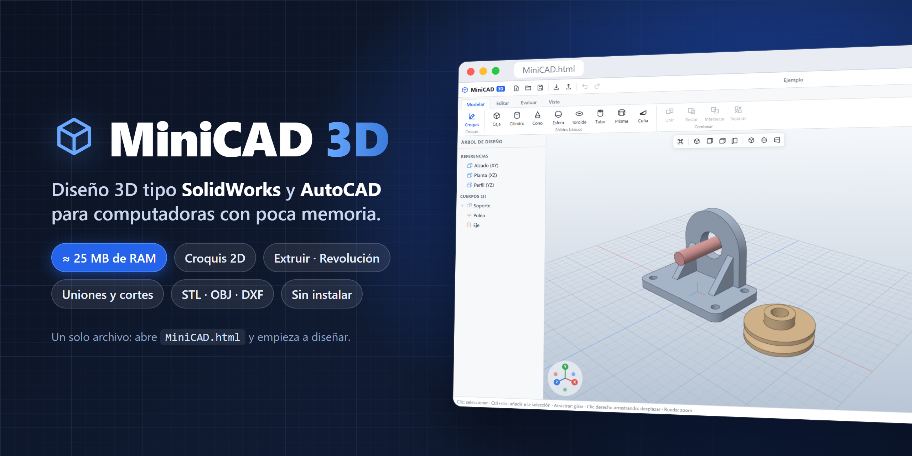
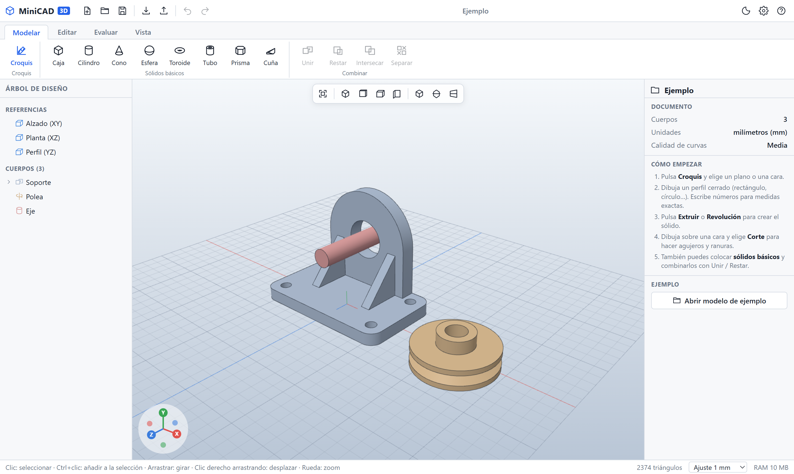

<p align="center"></p>

# MiniCAD 3D

Modelador 3D ligero, al estilo de SolidWorks o AutoCAD, pensado para equipos con poca memoria.
Todo el programa está en **un único archivo**: `MiniCAD.html`.

## Descargar

<p align="center"><a href="https://github.com/alexisc07/minicad/releases/latest/download/MiniCAD.zip"><b>⬇️ Descargar MiniCAD para Windows (ZIP)</b></a></p>

1. Descarga **MiniCAD.zip** y descomprímelo (clic derecho → *Extraer todo*).
2. Haz doble clic en **`Instalar MiniCAD.bat`**. Si Windows muestra un aviso, pulsa *Más información* → *Ejecutar de todas formas*.
3. Listo: abre **MiniCAD 3D** desde el Escritorio o el menú Inicio.

No necesita permisos de administrador ni internet. Se desinstala desde *Configuración → Aplicaciones*.
Todas las versiones están en [Releases](https://github.com/alexisc07/minicad/releases).

## Cómo abrirlo

1. Haz doble clic en `MiniCAD.html`.
2. Se abre en tu navegador (recomendado **Microsoft Edge** o **Google Chrome**).
3. No necesita instalación ni internet.

### Acceso directo (recomendado)

Haz doble clic en **`Crear acceso directo.bat`**. Crea el icono **MiniCAD 3D** en el Escritorio y en el menú Inicio.
Con ese icono, MiniCAD se abre en su propia ventana, sin pestañas ni barra del navegador, como un programa instalado.

Para anclarlo a la barra de tareas: abre MiniCAD, haz clic derecho en su icono de la barra → **Anclar a la barra de tareas**.
Si mueves la carpeta a otro sitio, vuelve a ejecutar el `.bat`.

Consumo típico: entre 15 y 60 MB de memoria del programa. SolidWorks necesita entre 8 y 16 GB.
La pestaña completa del navegador suele ocupar entre 150 y 300 MB.

## Captura



> Para ver este modelo, pulsa **Abrir modelo de ejemplo** en el panel derecho (o abre `MiniCAD.html#demo`).

## Qué puede hacer

| Área | Funciones |
|---|---|
| **Croquis 2D** | Polilínea, rectángulo (con radio de esquinas), rectángulo centrado, círculo, polígono y ranura. Ajuste a rejilla y a puntos, cotas en vivo y medidas exactas escribiendo números. |
| **Operaciones** | Extruir (saliente o corte, normal, invertida, simétrica o "por todo") y revolución (de 1° a 360°). |
| **Sólidos básicos** | Caja, cilindro, cono, esfera, toroide, tubo, prisma y cuña. Todas sus medidas se pueden editar. |
| **Booleanas** | Unir, restar e intersecar. Son *paramétricas*: si cambias un operando, el resultado se recalcula. |
| **Edición** | Mover, rotar y escalar con gizmo o con valores numéricos, duplicar, simetría, matriz lineal y matriz circular. |
| **Evaluar** | Medir distancias (se ajusta a los vértices), propiedades físicas (volumen, área, masa, centro de masa) y vista de sección. |
| **Archivos** | Guardar y abrir proyectos `.mcad`, exportar a STL (impresión 3D) y OBJ, importar STL, OBJ y DXF (planos de AutoCAD), y exportar el croquis a DXF. |
| **Otros** | Deshacer y rehacer, autoguardado, tema claro u oscuro, vistas estándar y proyección en perspectiva u ortogonal. |

## Flujo de trabajo básico (como en SolidWorks)

1. **Croquis**: elige un plano (Alzado, Planta, Perfil) o haz clic sobre una cara de un sólido.
2. Dibuja un perfil cerrado. Mientras dibujas, escribe una medida, por ejemplo `80x50` y Enter.
3. Pulsa **Extruir** o **Revolución**, ajusta la profundidad y pulsa ✓.
4. Para hacer agujeros, dibuja sobre una cara y elige **Corte**.

## Ratón y teclado

- **Clic izquierdo**: seleccionar (Ctrl+clic para seleccionar varios).
- **Arrastrar con el botón izquierdo**: girar la vista. Dentro del croquis se gira con el botón central.
- **Arrastrar con el botón derecho**: desplazar la vista.
- **Rueda**: zoom.
- **W / E / R**: mover, rotar o escalar.
- **K**: croquis. **M**: medir. **F**: ajustar la vista. **1 2 3 4**: vistas.
- **Ctrl+Z / Ctrl+Y**: deshacer y rehacer. **Ctrl+S**: guardar. **Supr**: eliminar. **F1**: ayuda.

## Consejos para ahorrar memoria

- En **Opciones** baja la *Calidad de curvas* a "Baja".
- Activa el **Modo ligero** (sin suavizado de bordes; se aplica al recargar).
- Cierra otras pestañas del navegador mientras modelas.

## Para desarrolladores

El código fuente está en `src/`. Para regenerar `MiniCAD.html`:

```bash
npm install
npm run build
```

Pruebas de geometría: `node test/geo.test.mjs`.

Usa three.js para el 3D, Manifold (WebAssembly) para las booleanas y three-bvh-csg como motor de respaldo.
